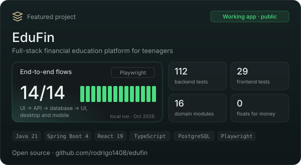
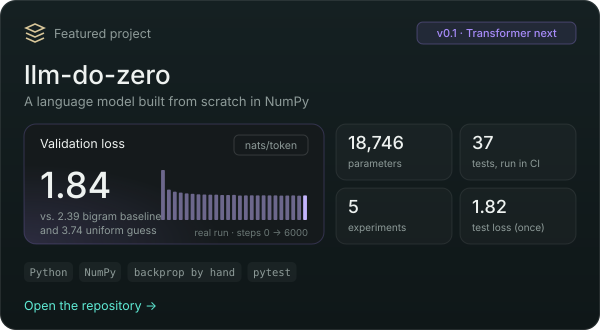
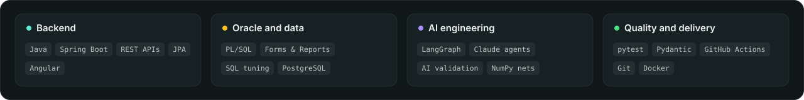

  Java and Oracle PL/SQL developer from Brazil, working on enterprise systems since 2020. 
  I build AI tools for legacy modernization where deterministic code extracts the facts, 
  and every AI step has to show its evidence before it counts.

  <a href="https://rodrigo1408.github.io"><b>Interactive portfolio</b></a> ·
  <a href="https://www.linkedin.com/in/rodrigo-barreto-2b1ba6129/">LinkedIn</a> ·
  <a href="mailto:rodrigomendesbarreto@hotmail.com">Email</a> ·
  <a href="https://rodrigo1408.github.io/Rodrigo_Barreto_Resume.pdf">Resume (PDF)</a>

 

  
  

<b>More about the projects</b>

 

**[EduFin](https://github.com/rodrigo1408/edufin_ai)**. A financial education platform for all ages: savings goals, income and expense tracking, an interest calculator, progressive courses, quizzes, healthy gamification, reports, a moderated community and simulated investment wallets. A modular Spring Boot 4 (Java 21) monolith serves a React 19 + TypeScript SPA on the same origin, backed by PostgreSQL and Flyway.
- Security from the start: server-side sessions with HttpOnly cookies and CSRF, role-based permissions, per-user data isolation, rate limiting, and LGPD data export and deletion.
- Money is `BigDecimal`/`NUMERIC`, balances are derived from the movement history, and quiz scores are computed only on the server.
- 119 backend tests, 34 frontend tests and 14 Playwright end-to-end flows that go from the UI to the database and back.

**[llm-do-zero](https://github.com/rodrigo1408/llm-do-zero)**. A character-level language model with hand-written backpropagation, no autograd and no pretrained weights. Every gradient is checked against finite differences, and the five experiments are generated by code.

**Other work: LIMIAR** (private repository, walkthrough on request). A multi-agent platform that migrates Oracle Forms/Reports, exported as XML, to Java/Spring Boot, with deterministic extraction before every AI step and human-approved merges.

 

  Earlier Spring Boot practice projects:
  <a href="https://github.com/rodrigo1408/api_ev">api_ev</a> ·
  <a href="https://github.com/rodrigo1408/api_atendimento">api_atendimento</a> ·
  <a href="https://github.com/rodrigo1408/gate-unlock">gate-unlock</a> ·
  <a href="https://github.com/rodrigo1408/api_semaforo">api_semaforo</a>

