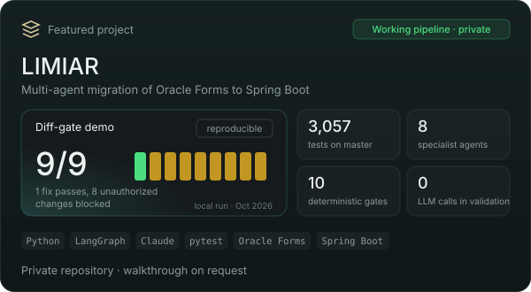

  Java and Oracle PL/SQL developer from Brazil, working on enterprise systems since 2020. 
  I build AI tools for legacy modernization where deterministic code extracts the facts, 
  and every AI step has to show its evidence before it counts.

  <a href="https://rodrigo1408.github.io"><b>Interactive portfolio</b></a> ·
  <a href="https://www.linkedin.com/in/rodrigo-barreto-2b1ba6129/">LinkedIn</a> ·
  <a href="mailto:rodrigomendesbarreto@hotmail.com">Email</a> ·
  <a href="https://rodrigo1408.github.io/Rodrigo_Barreto_Resume.pdf">Resume (PDF)</a>

 

  
  

<b>More about the projects</b>

 

**LIMIAR** (private repository, walkthrough on request). A multi-agent platform that migrates Oracle Forms/Reports, exported as XML, to Java/Spring Boot. Eight specialist agents rebuild the business rules, design the target architecture and generate code. Anything the XML does not support is reported as missing, never guessed.
- Deterministic extraction before every AI step; eight validation layers with zero LLM calls.
- **LIMIAR Maintenance:** agents investigate and fix queued bugs, but a PR opens only when 10 deterministic gates pass, and merge is always human.

**[llm-do-zero](https://github.com/rodrigo1408/llm-do-zero)**. A character-level language model with hand-written backpropagation, no autograd and no pretrained weights. Every gradient is checked against finite differences, and the five experiments are generated by code.

 

  Earlier Spring Boot practice projects:
  <a href="https://github.com/rodrigo1408/api_ev">api_ev</a> ·
  <a href="https://github.com/rodrigo1408/api_atendimento">api_atendimento</a> ·
  <a href="https://github.com/rodrigo1408/gate-unlock">gate-unlock</a> ·
  <a href="https://github.com/rodrigo1408/api_semaforo">api_semaforo</a>

